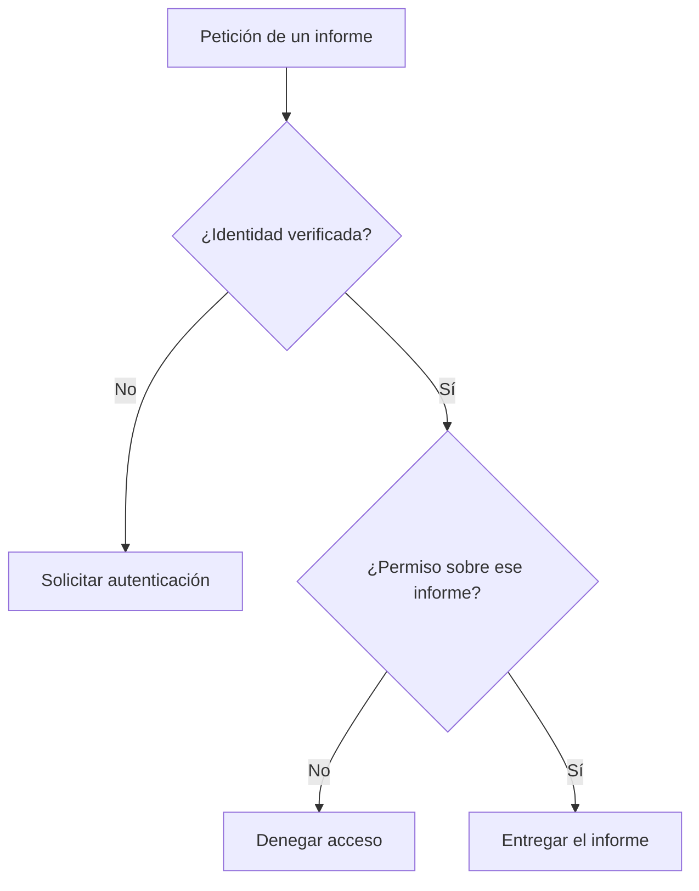

import useBaseUrl from '@docusaurus/useBaseUrl';

> **Diapositivas de origen:** parte 1, 3–9. <a href={useBaseUrl('/descargas/DAS_Parte_1_Final.pdf') + '#page=3'}>Abrir el PDF en la primera diapositiva</a>.

Una aplicación puede **cumplir su función y seguir siendo insegura**. Descargar un informe propio es correcto; descargar el de otra persona aprovechando el mismo botón no lo es.

## Dos datos para empezar

| Dato de las diapositivas | Qué significa | Qué no podemos concluir |
|---|---|---|
| **Más de 311.000 millones** de ataques web y contra API observados en 2024; **+33 % interanual**. Akamai, informe de 2025. | El volumen observado aumentó respecto al año anterior. | Que se produjeran 311.000 millones de intrusiones o que se haya medido todo Internet. |
| **+47 %** en el tiempo de corrección de fallos de seguridad desde 2020. Veracode, informe de 2025. | Encontrar un fallo no garantiza corregirlo pronto. | Que todas las organizaciones tarden lo mismo o que la causa sea siempre programar despacio. |

**Incremento interanual** significa comparar con el año anterior: pasar de 100 a 133 supone crecer un 33 %. **Intento de ataque** es una acción que busca comprometer un sistema; **intrusión** implica que se ha conseguido acceso o control no autorizado. Muchos intentos se bloquean.

[Akamai, publicación de los datos](https://www.akamai.com/newsroom/press-release/akamai-research-web-attacks-up-33-apis-emerge-as-primary-targets) · [Veracode, informe 2025](https://www.veracode.com/resources/analyst-reports/state-of-software-security-2025/).

## Seguridad desde los requisitos

Las diapositivas llaman **ReservaLab** a un ejemplo ficticio de reservas e informes. Sirve para hablar de estudiantes, responsables y permisos. **No hay que instalar una aplicación con ese nombre para seguir estos apuntes.**

| Requisito | Prueba que lo comprueba |
|---|---|
| Una estudiante puede consultar su informe. | Accede con su sesión y recibe su informe. |
| Una estudiante no puede consultar informes ajenos. | Cambia el identificador por el de otra persona y el servidor deniega el acceso. |
| Un responsable solo accede a su ámbito. | Intenta consultar un informe fuera de ese ámbito y se rechaza. |

El primer caso comprueba la función prevista; los otros comprueban **límites de autorización**. Ocultar un enlace en la interfaz no sustituye la comprobación en el servidor.

**Autenticación** responde «¿quién eres?». **Autorización** responde «¿qué puedes hacer con este recurso?». Una sesión válida solo resuelve la primera pregunta.

## Del hallazgo a la corrección instalada

Un **hallazgo** es un problema detectado que debemos revisar. Puede atascarse al confirmar su alcance, asignar una persona responsable, decidir la prioridad, preparar el parche, probarlo o desplegarlo.

| Paso | Pregunta necesaria |
|---|---|
| Descubrimiento | ¿Qué falla y cómo se demuestra? |
| Comunicación | ¿Quién necesita conocerlo para actuar? |
| Corrección | ¿El cambio elimina la causa? |
| Despliegue | ¿Qué instalaciones han recibido el cambio? |
| Verificación | ¿El fallo ha desaparecido y sigue funcionando el uso legítimo? |

La explotación puede ocurrir **antes del aviso público**: alguien puede descubrir y aprovechar el problema antes de que lo conozcan el fabricante o los usuarios. Tampoco todos los avisos tienen un parche disponible en ese momento.

Una **prueba de regresión** conserva una comprobación para detectar si un cambio posterior vuelve a introducir el fallo. Por ejemplo: después de cada cambio, confirmar que una estudiante sigue sin poder descargar informes ajenos.

En el ejemplo de versiones de las diapositivas, una instalación tiene la versión corregida, otra conserva la afectada y una tercera ni siquiera está inventariada. **Publicar un parche y tener todos los sistemas corregidos son estados distintos.**

Para pensar: hay un parche, ¿podemos cerrar ya el hallazgo?

No basta con que exista. Hay que saber si se ha aplicado a las instalaciones afectadas y verificar el resultado. Un inventario incompleto deja una parte de la respuesta sin resolver.

Apoyo para explicar en clase

Veracode es una empresa y plataforma de seguridad de aplicaciones; no es el nombre de una vulnerabilidad. Antes de comparar tiempos, fijar el inicio —primera detección, confirmación o asignación— y el final —cambio escrito, parche integrado o despliegue verificado—. Intervalos distintos no miden lo mismo.

