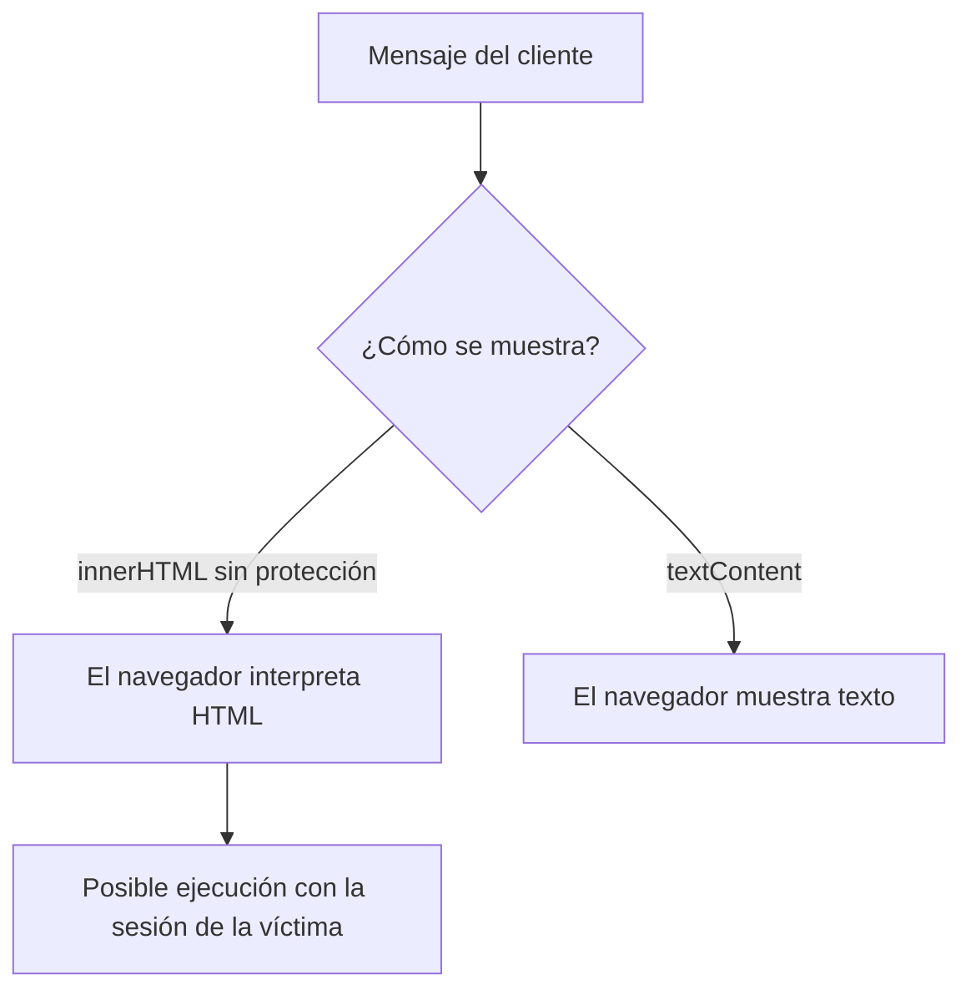

import useBaseUrl from '@docusaurus/useBaseUrl';

> **Diapositivas de origen:** parte 1, 14–16. <a href={useBaseUrl('/descargas/DAS_Parte_1_Final.pdf') + '#page=14'}>Abrir el PDF en la primera diapositiva</a>.

En el banco ficticio de las diapositivas, una persona envía un mensaje que posteriormente lee un administrador. El problema aparece si la aplicación inserta ese mensaje como **HTML interpretable**.

## Localizar la frontera de confianza

```javascript
// Fragmento vulnerable de la diapositiva.
panel.innerHTML = mensajeCliente;
```

`mensajeCliente` procede de otra persona. `innerHTML` interpreta etiquetas y atributos. Se ha permitido que quien escribe un mensaje influya en la estructura de la página que lee el administrador.



El ejemplo del PDF introduce una imagen cuyo manejador de error intenta enviar una petición de aprobación de una transferencia. **El script intenta una acción con la sesión de quien lee el mensaje**. Que la transferencia llegue a aprobarse depende también de los controles del servidor: permisos, estado de la operación y, cuando corresponda, confirmación adicional.

## Una corrección para mensajes de texto

```javascript
// Adecuado cuando el mensaje debe ser texto, sin formato HTML.
panel.textContent = mensajeCliente;
```

Ahora las etiquetas se presentan como texto. Si el producto necesita permitir HTML, hay que definir qué formato acepta y utilizar una sanitización adecuada; sustituir palabras como `script` no resuelve el problema general.

## Cómo comprobar el cambio

| Entrada | Resultado esperado tras corregir |
|---|---|
| `Necesito revisar mi transferencia` | Se muestra el mensaje completo. |
| `<b>Urgente</b>` | Se muestran literalmente las etiquetas si el contrato es texto plano. |
| La entrada de prueba del PDF | No ejecuta el manejador ni envía la petición de aprobación. |

La clasificación es **CWE-79**. La corrección debe estar donde los datos llegan a la salida peligrosa, además de conservar las comprobaciones de autorización de las operaciones sensibles.

<details>
<summary>Para pensar: ¿el cliente necesita conocer la contraseña del administrador?</summary>

No necesariamente. El navegador del administrador ya puede tener una sesión iniciada. Esa es la razón por la que ejecutar código en el contexto de una página legítima es peligroso.

</details>

La parte 2 amplía los [tipos de XSS y las defensas](../sesion-07/xss.md). Referencia: [OWASP, prevención de XSS](https://cheatsheetseries.owasp.org/cheatsheets/Cross_Site_Scripting_Prevention_Cheat_Sheet.html).
