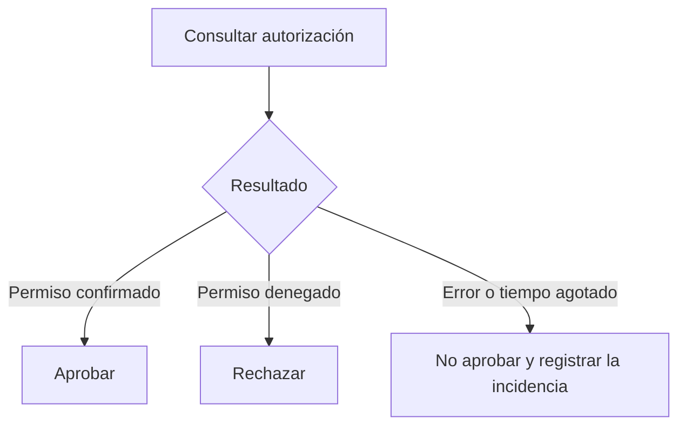

import useBaseUrl from '@docusaurus/useBaseUrl';

> **Diapositivas de origen:** parte 1, 23–26. <a href={useBaseUrl('/descargas/DAS_Parte_1_Final.pdf') + '#page=23'}>Abrir el PDF en la primera diapositiva</a>.

Una aplicación debe decidir correctamente **aunque lleguen peticiones simultáneas o falle una dependencia**. El recorrido normal no cubre estas situaciones.

## Dos peticiones para una sola plaza

| Momento | Petición A | Petición B |
|---|---|---|
| 1 | Lee: queda 1 plaza. | |
| 2 | | Lee: queda 1 plaza. |
| 3 | Confirma la reserva. | |
| 4 | | Confirma otra reserva. |

Las dos comprobaciones fueron verdaderas cuando se hicieron, pero se ha incumplido la regla **«una sola reserva para esa plaza»**. El problema es separar una comprobación y una actualización que deben coordinarse.

La solución puede usar una operación atómica, bloqueo o una transacción con restricciones adecuadas. No basta con añadir otra consulta justo antes: otra petición podría intercalarse de nuevo. La prueba debe ejecutar dos solicitudes concurrentes y comprobar cuántas se confirman.

## Cuando falla el servicio de autorización

En el segundo ejemplo, una transferencia de 250.000 euros depende de un servicio que confirma si se permite. Si una excepción lleva a aprobar la transferencia, el sistema **falla concediendo acceso** (*fail open*).

```python
# Esquema vulnerable: una avería se interpreta como permiso.
try:
    permitido = consultar_autorizacion(transferencia)
except TimeoutError:
    permitido = True
```

El comportamiento seguro para esta operación es **no aprobar sin autorización confirmada**:

```python
# Esquema de la alternativa explicada en las diapositivas.
try:
    permitido = consultar_autorizacion(transferencia)
except TimeoutError:
    logger.exception("Servicio de autorización no disponible")
    abort(503)
if not permitido:
    abort(403)
aprobar_transferencia(transferencia)
```

`503` indica que no se pudo prestar el servicio; `403`, que el acceso se deniega. Conviene distinguir ambos estados para usuarios, operaciones y monitorización.



<details>
<summary>¿Qué tres pruebas pedirías para la transferencia?</summary>

Permiso confirmado: se aprueba una vez. Permiso denegado: no se aprueba. Servicio indisponible: tampoco se aprueba y queda un registro de la incidencia sin revelar datos sensibles. Si se permiten reintentos, hay que evitar aprobaciones duplicadas.

</details>
