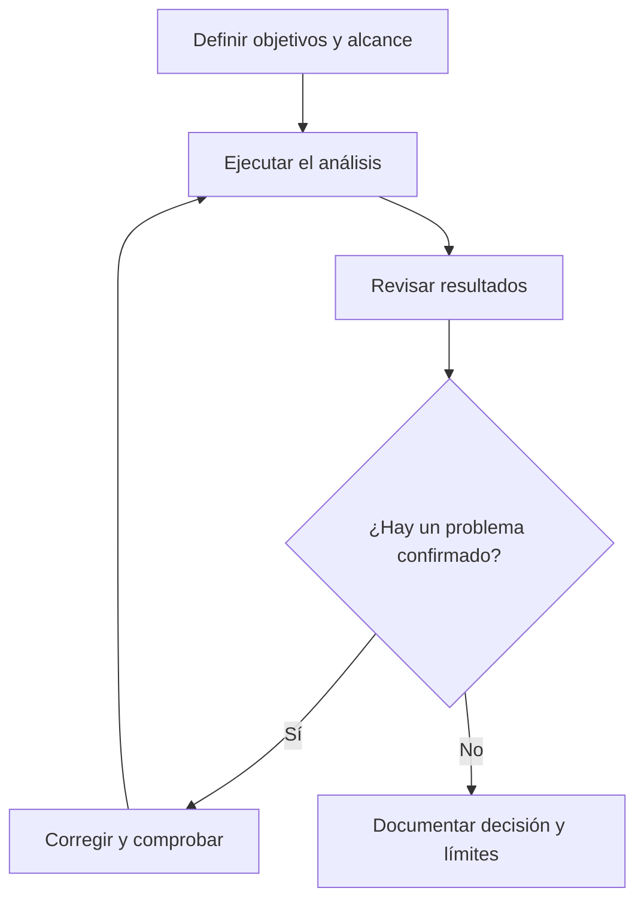

import useBaseUrl from '@docusaurus/useBaseUrl';

> **Diapositivas de origen:** parte 1, 49–50. <a href={useBaseUrl('/descargas/DAS_Parte_1_Final.pdf') + '#page=49'}>Abrir el PDF en la primera diapositiva</a>.

Revisar código no consiste en entregar una lista larga de avisos. Consiste en **convertir observaciones en decisiones justificadas y cambios verificables**.

## El ciclo de revisión

Las reglas y el código producen resultados brutos. La revisión humana añade el contexto necesario: entradas posibles, permisos, controles, impacto y evidencia.

## Una ficha breve por hallazgo

| Campo | Qué escribir |
|---|---|
| Localización | Archivo, función y versión revisada. |
| Causa | Qué control falta o es incorrecto; CWE si procede. |
| Condiciones | Qué entrada, usuario o estado permiten el fallo. |
| Evidencia | Pasos y resultado observado, sin datos reales sensibles. |
| Corrección | Qué cambia y por qué elimina la causa. |
| Regresión | Qué prueba conservar para evitar que vuelva. |

Por ejemplo, en la exportación de nóminas no basta «falta seguridad». Una explicación útil es: «un usuario autenticado sin función de RR. HH. recibe todas las nóminas porque la ruta solo comprueba la sesión; la prueba tras corregir debe devolver denegación y mantener el acceso del rol permitido».

## Usar IA sin perder la evidencia

Una IA puede ayudar a explicar el fragmento o sugerir una prueba. Quien revisa debe contrastar la propuesta con el código y el resultado real. **Una respuesta convincente no sustituye una ejecución ni una fuente técnica.**

Para una actividad breve basta elegir un fragmento de las diapositivas y responder: qué entra, qué operación peligrosa alcanza, qué control falta y cómo se comprobaría el cambio. No hace falta redactar un artículo para explicar bien el hallazgo.

¿Qué diferencia hay entre «corregido» y «verificado»?

«Corregido» puede significar que se ha escrito un cambio. «Verificado» añade que se han ejecutado las comprobaciones pertinentes y observado el resultado esperado. Al cerrar un hallazgo conviene indicar también si el cambio está desplegado.

