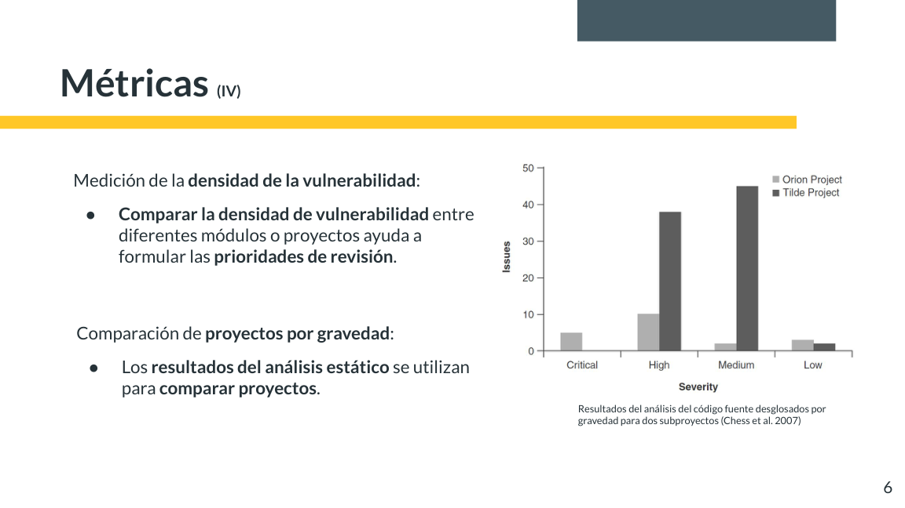
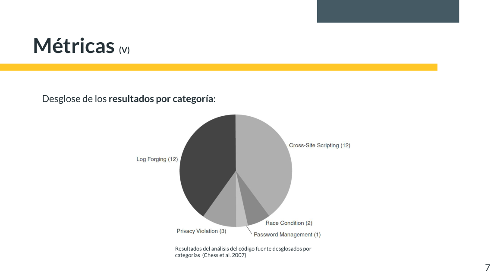
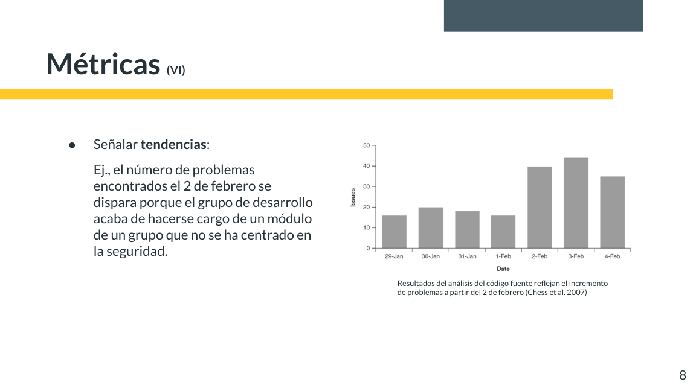
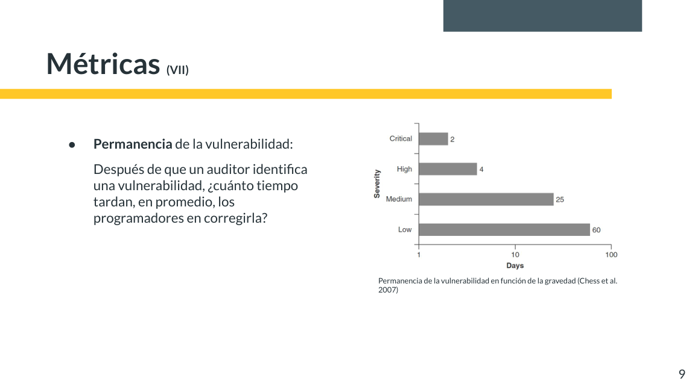

import useBaseUrl from '@docusaurus/useBaseUrl';

> **Diapositivas de origen:** parte 2, 3–9. <a href={useBaseUrl('/descargas/DAS_Parte_2_Final.pdf') + '#page=3'}>Abrir el PDF en la primera diapositiva</a>.

Una métrica es útil si sabemos **qué cuenta, sobre qué conjunto y para qué decisión**. El número de alertas, la cantidad de defectos confirmados y el riesgo del sistema no son lo mismo.

## Densidad de defectos

La densidad relaciona defectos con tamaño; por ejemplo, defectos confirmados por mil líneas de código. Antes de comparar, hay que mantener criterios similares de análisis, exclusión de código generado, lenguaje, reglas y validación de resultados.

Las diapositivas muestran un programa que calcula el índice de masa corporal y utiliza dos llamadas a `gets`. Una refactorización mueve la lectura a `getNumber` y deja **una única llamada escrita a `gets`, reutilizada dos veces**.

| Antes | Después | Qué ha cambiado realmente |
|---|---|---|
| Dos llamadas escritas a una función de entrada insegura. | Una llamada escrita dentro de una función auxiliar. | La organización del código; no se ha añadido un límite de lectura. |

Un contador de ubicaciones puede bajar sin que se elimine la debilidad. **Refactorizar no equivale a corregir.** `gets` es una función histórica insegura, eliminada del estándar C11; el ejemplo se analiza como código legado, no como recomendación para implementar entradas hoy.

## Separar cantidad, gravedad y categoría

*Diapositiva 6 del PDF final. Figura atribuida allí a Chess et al., 2007; ejemplo histórico, no medición del Hub.*

El proyecto con más avisos totales no tiene necesariamente más avisos críticos. Además, el eje del gráfico muestra **recuentos**, no densidades normalizadas por tamaño. Antes de establecer prioridades hay que revisar las incidencias y su contexto.

*Diapositiva 7. Desglose histórico de ejemplo, atribuido a Chess et al., 2007.*

La categoría permite orientar acciones: formación sobre salidas HTML si predominan XSS, o revisión de registros si hay falsificación de eventos. La figura no demuestra que esas proporciones describan todos los proyectos actuales.

## Leer una tendencia con su contexto

*Diapositiva 8. El propio ejemplo explica un cambio de alcance.*

El aumento del 2 de febrero se relaciona con la incorporación de un módulo. **Puede haber más problemas registrados porque se analiza más código**, no porque el equipo haya introducido todos esos defectos ese día. Anotar cambios de alcance y de reglas hace interpretable una serie.

## Medir el tiempo de corrección

*Diapositiva 9. El eje temporal usa escala logarítmica; los valores son del ejemplo citado, no compromisos de resolución.*

Para comparar tiempos hay que definir el mismo intervalo: desde detección o confirmación hasta parche integrado o despliegue verificado. También hay que decir qué se hace con los hallazgos que **siguen abiertos**; excluirlos sin explicarlo puede ofrecer una imagen demasiado favorable.

Pregunta de clase: pasamos de 20 a 10 avisos, ¿ha mejorado la seguridad?

No se puede concluir solo con ese dato. Puede haber correcciones reales, reglas desactivadas, menos código analizado o cambios en cómo agrupa los avisos la herramienta. Necesitamos saber qué cambió y revisar evidencias.

