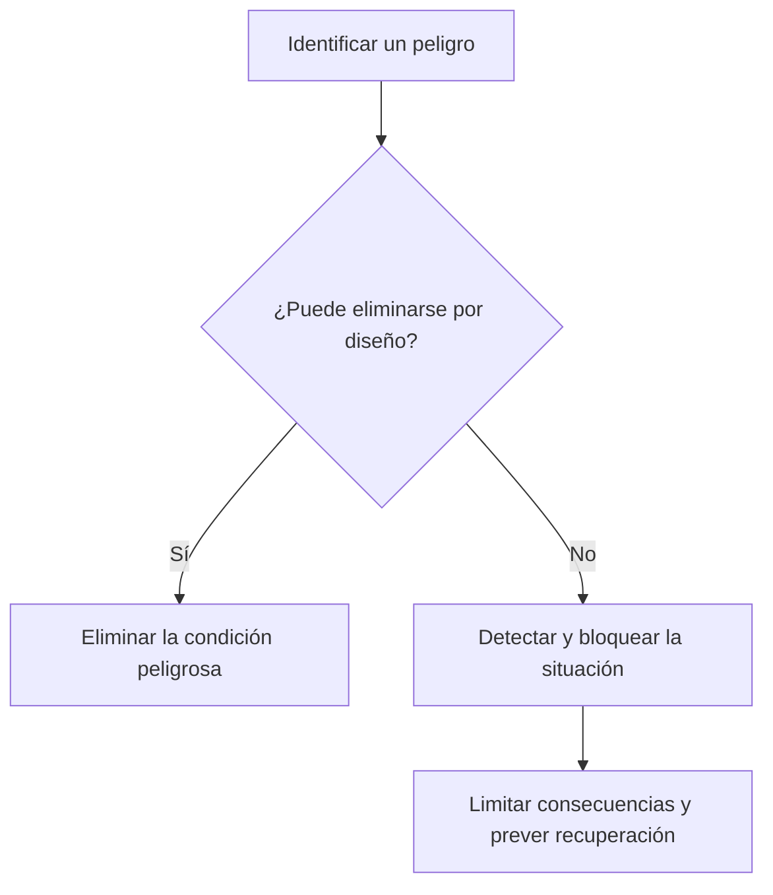

import useBaseUrl from '@docusaurus/useBaseUrl';

> **Diapositivas de origen:** parte 2, 45–48. <a href={useBaseUrl('/descargas/DAS_Parte_2_Final.pdf') + '#page=45'}>Abrir el PDF en la primera diapositiva</a>.

En este contexto, **safety** es la protección frente a daños físicos inaceptables a personas o al entorno. No exige que haya una persona atacante: un requisito incompleto, un fallo de software o una interacción imprevista pueden causar daño.

## Sistemas que actúan directamente y sistemas que informan decisiones

| Tipo del material | Relación con el daño | Ejemplo |
|---|---|---|
| Primario | El sistema controla directamente un proceso o dispositivo. | Equipo de radioterapia como el caso histórico Therac-25. |
| Secundario | La información del sistema guía una decisión con consecuencias físicas. | Una base de datos que muestra una dosis de medicamento errónea. |

Therac-25 se estudia por accidentes de radioterapia de 1985–1987 y por la interacción entre software, equipos y procesos. La lección no es que «el software siempre sea menos seguro», sino que deben analizarse **el sistema completo y sus barreras de protección**.

## Evitar, detectar y limitar

El material usa ejemplos como impedir que un microondas opere con la puerta abierta. El control útil no es solo un mensaje que diga «cierre la puerta», sino una barrera que impida la acción peligrosa.

En sensores y automatismos hay que especificar qué magnitud se detecta, qué umbral se usa y qué respuesta es segura en ese sistema. No es correcto intercambiar CO y CO₂ ni generalizar una medida de corte de energía a todos los entornos.

## Analizar un peligro con cuatro preguntas

1. ¿Qué daño queremos evitar?
2. ¿Qué combinación de estados puede producirlo?
3. ¿Qué barrera lo impide o limita?
4. ¿Cómo comprobamos que esa barrera funciona, también cuando falla un componente?

¿Puede ser relevante para safety una base de datos que no controla ninguna máquina?

Sí. Si su información conduce a una decisión peligrosa, como administrar una dosis equivocada, el sistema puede contribuir al daño aunque no accione físicamente el equipo.

Para ampliar el caso histórico: [Leveson y Turner, investigación de Therac-25](https://web.mit.edu/6.033/2004/wwwdocs/papers/Therac_1.html). No se usan los ejemplos del curso como instrucciones operativas para equipos reales.
